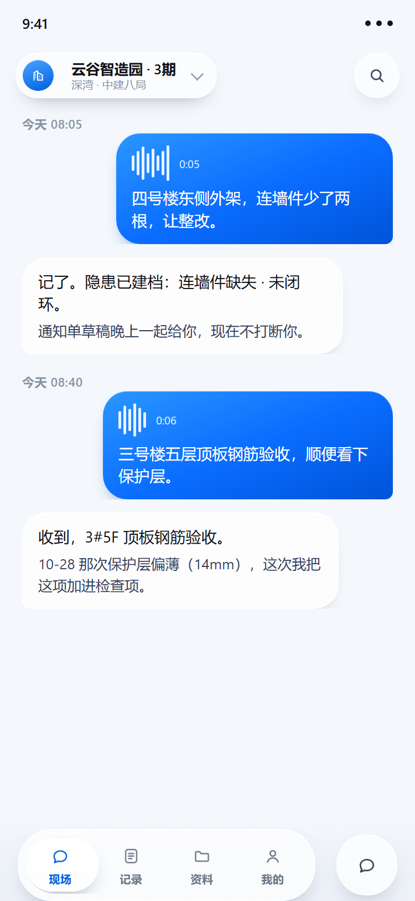
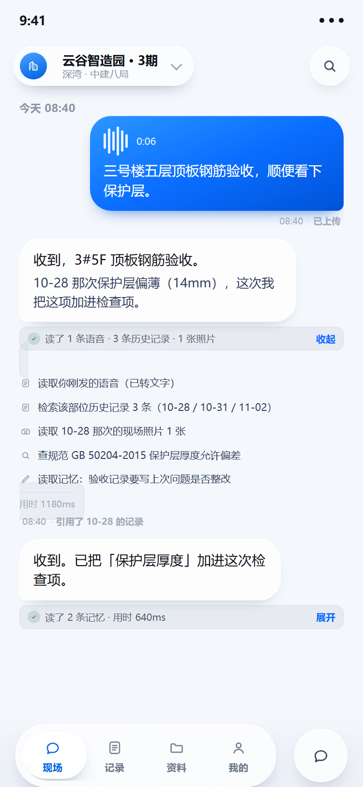
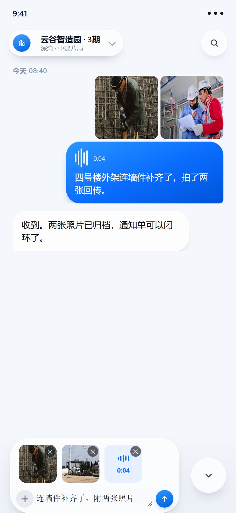
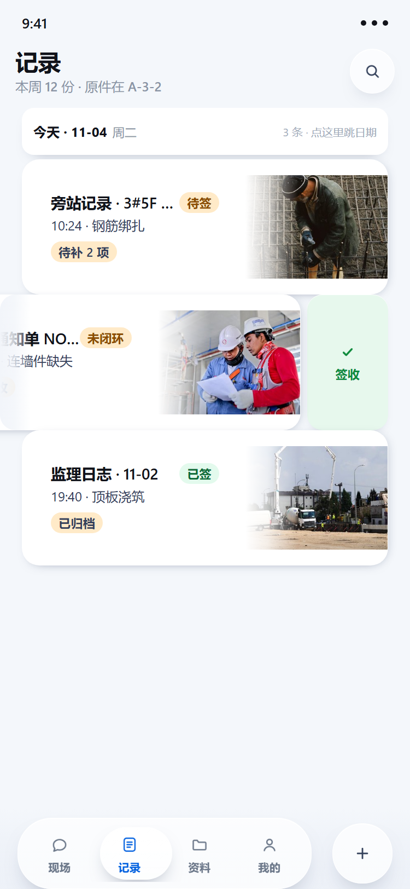
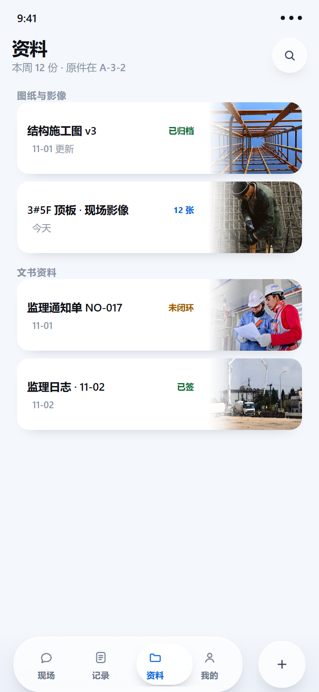
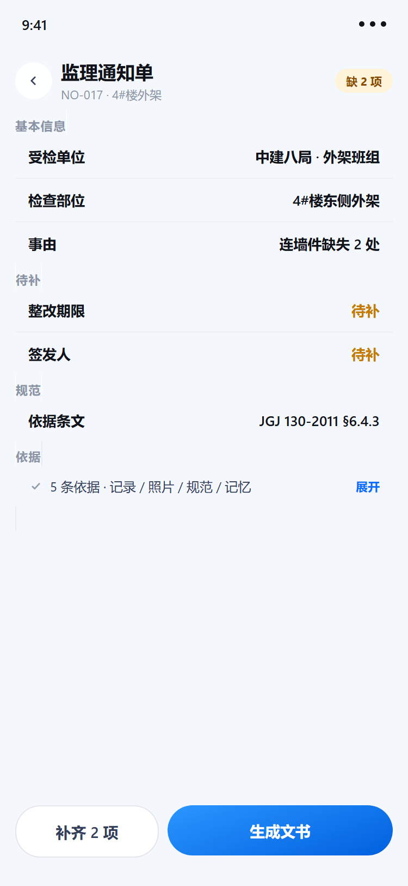
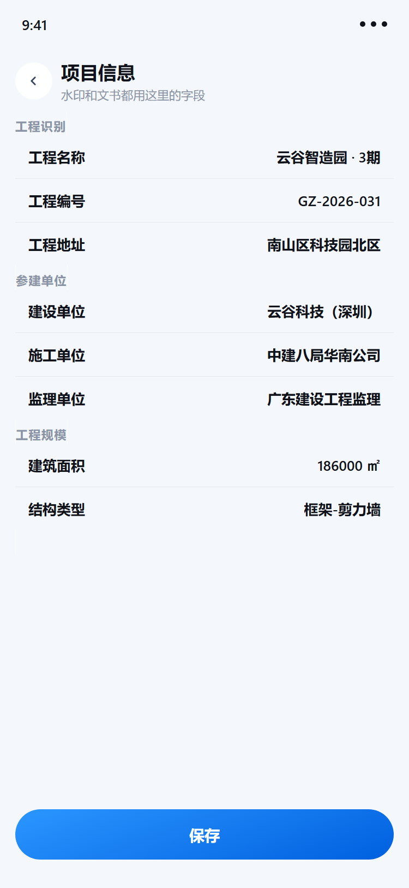
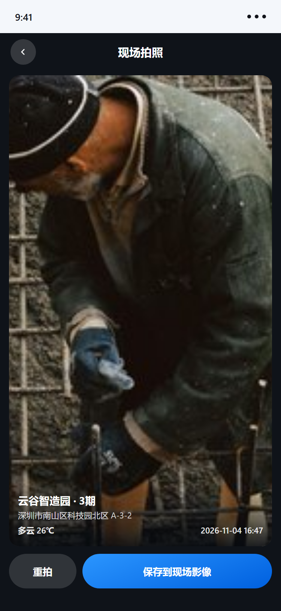
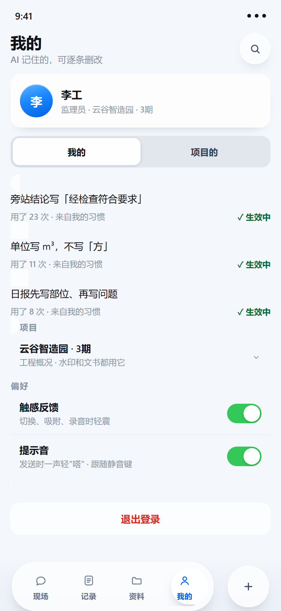

# 监理现场助手 · 微信小程序

广东建设工程监理有限公司的现场记录工具。

监理员在工地**说一句话、拍一张照片**，系统自动整理成旁站记录、监理通知单、监理日志——不用回办公室补表。



---

## 它解决的问题

监理员的一天是这样过的：上午旁站浇筑，顺手发现外架连墙件少了两根，下午要出整改通知单，晚上还要写监理日志。

但现实是——**现场记得下，回来补不上**。手机上零散记的语音、拍的照片，晚上要一条条翻、一条条誊进表格。

这个工具把这套流程压成一句话：

> **现场怎么记，就怎么记。整理是它的事。**

---

## 三条设计原则

| 原则 | 意思 |
|---|---|
**记录一切** | 文字、照片、语音，随便混着来，一条消息装下全部 |
**零必填** | 当时不知道的字段（方量、试块组数）留空也能存 |
**不阻塞** | 缺项只标"待补"，绝不挡住下一步；回头补 |

缺的字段不会消失，它在文书详情里等着你——**记录的时候不打断人，补全的时候才提醒**。

---

## 四个页面 + 三个详情页

### 一、现场：一句话就是一条记录


**操作**

1. 底部胶囊默认是「按住 说话」——按住说，松手发送
2. 说「四号楼东侧外架，连墙件少了两根」，松开
3. 它回一句「记了。隐患已建档：连墙件缺失 · 未闭环」，并告诉你晚上给草稿

**它做的事**：识别部位、构件、问题类型，先建一条隐患档案，不打扰你继续干活。

**每条消息下面有一行元信息**：

```
我发的   08:05 · 已上传
助手说   08:05 · 基于今天的记录
我发的   15:02 · 待上传      ← 工地信号差时，一眼看出哪条还没传上去
```

**长按气泡**可以：复制 / 引用 / 转发到群 / 转成文字（语音）/ 删除。

**引用**是这套流程的关键——助手回你时，会带上它依据的那条原文：

```
┌ 10-28 同部位 ─────────────┐
│ 保护层偏薄 14mm，要求复查   │
├───────────────────────────┤
│ 收到，3#5F 顶板钢筋验收。   │
│ 这次我把保护层加进检查项。   │
└───────────────────────────┘
```

你引用它、它引用你，**一条记录从哪来、依据什么**，都留得住。

---

### 助手每次都交代：它看了什么、查了什么、用了多久



**收起时一行**：

```
✓ 读了 1 条语音 · 3 条历史记录 · 1 张照片            收起
```

**点开展开**，逐条列出来：

```
🗎  读取你刚发的语音（已转文字）
🗎  检索该部位历史记录 3 条（10-28 / 10-31 / 11-02）
📷  读取 10-28 那次的现场照片 1 张
🔍  查规范 GB 50204-2015 保护层厚度允许偏差
✎   读取记忆：验收记录要写上次问题是否整改
                                    用时 1180ms
```

**为什么这个必须有**：监理的每一条结论都要能追到依据——读了哪条记录、比对了哪张照片、引了哪条规范。这不是"AI 功能展示"，是**监理资料的可追溯性**。

出事倒查的时候，你能说清"当时为什么这么判"。

---

### 二、一条消息里，文字 / 图片 / 语音自由组合



**操作**

1. 点底部 💬 进入输入态，再点左边的 🎤 切到打字
2. 点左边的 `＋`：拍照 / 从相册选 / 录一段语音 / 从聊天导入 / 粘贴文字
3. 拍两张、录一段，附件排在上方，每个都能单独删
4. 补一句文字，点 ↑ 发送

**发出去是一条**：图片在上，语音条和文字在同一个气泡里。

> 为什么重要：整改回复往往是「照片 + 一句说明」，分成三条发，晚上整理时又得拼回去。

---

### 三、记录：卡片、右滑签收、吸顶日期



**操作**

1. 顶部日期条**吸住**，滚到下一段时被顶走
2. 点日期条 → 选任意日期 → 列表**跳到那一段**
3. 在卡片上**向左滑**，露出动作卡：待签是绿色「签收」，已签是灰色「查看」
4. 点一下，状态就地变成「已签」

**卡片的样子**：左边是文字（类型 · 部位、时间、状态），右边是**真实现场照片**，
图和卡片之间是渐隐过渡，不是贴一个方块。

---

### 四、资料：图纸、影像、文书，一处收齐



**操作**

1. 分两组：**图纸与影像** / **文书资料**
2. 影像类**有内容就显示最新那张照片**，没有才用示意图
3. 长按任意一行：预览 / 从资料里移除
4. 点右上角搜索，跨这四个页面搜

---

### 五、文书详情：补缺项，然后生成



**操作**

1. 从记录页点任意卡片进来
2. 字段按「基本信息 / 待补 / 依据」分组，**缺的标成橙色"待补"**
3. 点「补齐 2 项」，逐项填
4. 点「生成文书」→ 归档进资料页

**这是"零必填"的另一半**：记录时不拦你，缺口在这里集中还债。

**页面底部还有一块「依据」**——这份文书凭什么这么写：

```
✓ 5 条依据 · 记录 / 照片 / 规范 / 记忆        展开
```

点开是逐条：

```
🗎  现场记录 1 条：08:05 发现连墙件缺失 2 处
📷  现场照片 1 张：4#楼东侧外架缺失部位
📕  规范 JGJ 130-2011 §6.4.3 连墙件设置间距
⚠️  历史比对：10-28 同部位曾因连墙件被下过通知单
✎   你的记忆：隐患描述要带部位和数量
```

生成文书时，这份清单会附在文书后面。**出去的不是一张单子，是单子加依据。**

---

### 六、项目信息：水印和文书的字段都来自这里



按《建设工程监理规范》工程概况表分了 5 组：

```
工程识别   名称 / 编号 / 地址 / 类别
参建单位   建设 / 施工 / 监理 / 设计 / 勘察
工程规模   建筑面积 / 层数 / 结构类型 / 造价
工期与许可 开工 / 竣工 / 施工许可证 / 监督机构
监理人员   总监 / 专业监理工程师 / 合同号
```

改完保存，**头部胶囊和拍照水印立刻跟着变**。

---

### 七、拍照：水印直接写进图片



**操作**

1. 现场页上拉抽屉 → 现场影像
2. 相机打开，拍一张
3. 取景页已经带好水印：**项目 / 位置 / 天气 / 时间**
4. 点保存 → 水印用 canvas **画进图片本身**，不是屏幕上的浮层

> 存下来发给甲方、贴进报告，水印都在。

---

### 八、我的：AI 记住你的写法



**操作**

1. 顶部是身份卡（姓名 · 角色 · 项目）
2. 中间是**记忆**：它学会的写法，比如「旁站结论写经检查符合要求」
3. 长按任意一条 → 停用 / 删除
4. 抽屉里还有「手动写一条」「从对话里挑一句」
5. 下面依次是项目信息、偏好（触感 / 提示音）、退出登录

---

## 一天的完整路径

```
08:05  按住说话「外架连墙件少了两根」
       → 隐患自动建档

08:40  按住说话「顶板钢筋验收」
       → 提醒保护层厚度，上次偏薄

10:24  旁站浇筑，拍两张 → 加一句说明 → 发送
       → 旁站记录雏形

15:00  整改完成，拍两张回传
       → 通知单可闭环

18:00  打开记录页 → 右滑签收 → 生成日志
       → 资料页归档，缺项在详情页补齐
```

**全程没有"填表"这个动作。**

---

## 技术要点

| 点 | 做法 |
|---|---|
渲染 | 微信 **Skyline** 渲染引擎，自绘导航栏 |
底部胶囊 | 一个容器四种形态（导航 / 输入 / 抽屉 / 搜索），靠**变形**切换，不叠加 |
手势 | 拖动用 WXS 直改样式（不过 setData），松手回传 JS 做吸附 |
镜片 | 纯算术定位 + 弹性曲线，不依赖测量 |
图片 | 实拍素材 + 渐隐融合，不用图标代替 |
无障碍 | 关键控件带 `aria-label` |

---

## 目录

```
pages/
  index/      主页面（四个 tab 共用同一个底部胶囊）
  draft/      文书详情
  project/    工程概况编辑
  capture/    拍照 + 水印合成
  login/      微信登录
utils/
  request.js  统一请求层（401 / 超时 / 离线）
  geo.js      定位与天气
  upload.js   图片 / 音频上传
  store.js    本地数据仓
assets/
  covers/     现场实拍封面
  illus/      空状态插画（unDraw，已统一品牌色）
docs/
  接口契约.xlsx / .md   后端接口契约
  screenshots/          本文档用到的截图
```

---

## 许可

内部项目，未授权请勿分发。
